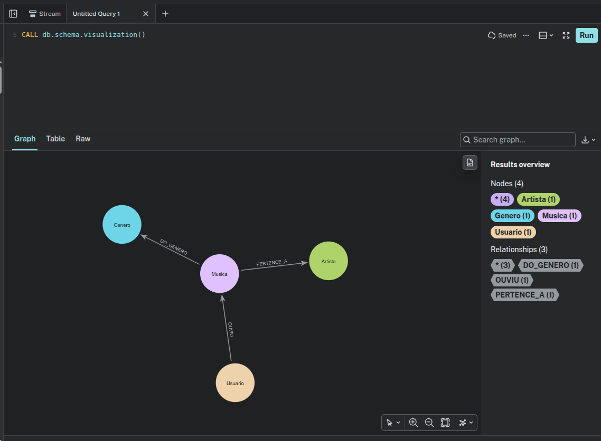
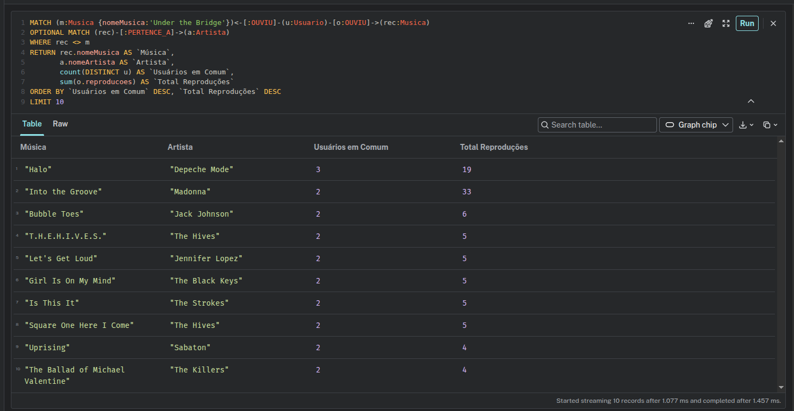

# Recomendação de Músicas com Neo4j

Sistema de recomendação de músicas usando banco de dados em grafos (Neo4j), no estilo **"quem ouviu esta música também ouviu..."**.

Desafio de Projeto da [DIO](https://www.dio.me/)

## Contexto

Plataformas de streaming precisam sugerir músicas novas para o usuário. A ideia aqui é simples: se muitos usuários que ouviram a música A também ouviram a música B, então B é uma boa recomendação para quem ouve A.

## Por que grafos?

A recomendação depende de relações: usuário → música → outros usuários → outras músicas. Num banco relacional isso exigiria vários joins. No grafo, a pergunta vira um caminho direto:

```
(Música) <-[OUVIU]- (Usuário) -[OUVIU]-> (Outra Música)
```

## Modelo do grafo



- **Usuario** `-[:OUVIU {reproducoes}]->` **Musica**
- **Musica** `-[:PERTENCE_A]->` **Artista**
- **Musica** `-[:DO_GENERO]->` **Genero**

Propriedades principais: `Musica.nomeMusica`, `Artista.nomeArtista`, `OUVIU.reproducoes`.

## Dados

Dataset do Kaggle: [NOME DO DATASET](LINK DO DATASET), com dois arquivos CSV.

Uma amostra dos arquivos está na pasta `data/`.

## Carga dos dados

A carga foi feita pela ferramenta **Import** do Neo4j Aura, sem script: os dois CSVs foram enviados e mapeados visualmente para os nós e relacionamentos do modelo.


## Query de recomendação

Quem ouviu "Under the Bridge" também ouviu o quê?

```cypher
// Usuários que ouviram a música e as outras músicas que eles ouviram
MATCH (m:Musica {nomeMusica:'Under the Bridge'})<-[:OUVIU]-(u:Usuario)-[o:OUVIU]->(rec:Musica)
WHERE rec <> m   // remove a própria música do resultado
OPTIONAL MATCH (rec)-[:PERTENCE_A]->(a:Artista)
RETURN rec.nomeMusica AS `Música`,
       a.nomeArtista AS `Artista`,
       count(DISTINCT u) AS `Usuários em Comum`,
       sum(o.reproducoes) AS `Total Reproduções`
ORDER BY `Usuários em Comum` DESC, `Total Reproduções` DESC
LIMIT 10
```

O ranking prioriza as músicas com mais usuários em comum e, no empate, as com mais reproduções.

## Resultado



## Dificuldades

- **Limite da instância gratuita do Aura:** um dos CSVs tinha registros demais e não cabia na instância Free. Resolvido usando metade das linhas desse arquivo.
- **`WHERE` depois do `OPTIONAL MATCH`:** nessa posição o `WHERE` só filtra o `OPTIONAL MATCH`, então a música de referência podia aparecer no resultado. Resolvido movendo o `WHERE` para logo depois do `MATCH`.

## Como executar

1. Crie uma instância gratuita no [Neo4j Aura](https://console.neo4j.io).
2. No **Import**, envie os dois CSVs e faça o mapeamento conforme o modelo acima.
3. No **Query**, rode a query de recomendação.

## Autor

Fernando (Nando) — [GitHub](https://github.com/Nthingtech)
